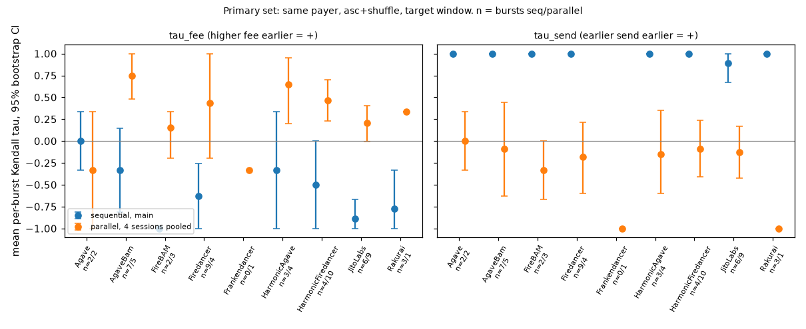

# Inside the Block: how Solana leaders order our transactions

`obp` (order-of-block probe) sends small memo transactions into chosen validators' 4-slot leader windows on Solana mainnet, then reads the blocks back and checks what decided each transaction's position: priority fee or send order. Results are grouped by validator client (Agave, JitoLabs, AgaveBam, HarmonicAgave, HarmonicFiredancer, Firedancer, FireBAM, Rakurai). All data is from live mainnet runs after Alpenglow (slot time about 0.212 s), measured on 2026-10-25 and 2026-10-31 UTC.

## Answer

- **Sent one after another, send order wins.** Main run, 125 bursts, 625/625 landed: `tau_send` +0.889 to +1.000 for all 8 labels, Holm significant for 6. A burst spans about 414 ms (two slots), so the fees never met in one scheduler batch.
- **Sent all at once, higher fee goes first on some clients.** Holm p < 0.05 for HarmonicFiredancer (+0.467, 10 bursts), AgaveBam (+0.747, 5) and HarmonicAgave (+0.650, 4). Firedancer and JitoLabs lean the same way but are not significant. Agave, FireBAM and Rakurai show no rule.
- **Fee did not buy landing.** Each of the 5 fee levels, zero included, landed 125/125 in the main run.
- **Across whole blocks, priority ordering is near zero** for every label (-0.091 to +0.058).
- **The send path matters more than the fee.** On 2026-10-31 the public RPC took a median 1.25 s per send and only 175 of 558 landed transactions reached the target leader.

Samples per label are small for the parallel design, and that design was chosen after the main run, so treat those results as exploratory. Full tables, p-values and caveats are in [REPORT.md](REPORT.md).



## The six points the brief asks about

Short version here, full text in [docs/DETAILS.md](docs/DETAILS.md#how-the-briefs-topics-are-addressed).

| Point | How we handle it |
|---|---|
| Leader schedule and leader types | `inventory` labels every validator by `clientId`, version and Jito/BAM flags. `plan` picks 4-slot windows from the epoch schedule, and `verify-windows` checks the real leader afterwards. |
| Path from backend to leader | `sendTransaction` on a public RPC, `skipPreflight`, `maxRetries: 0`, no automatic retries. The RPC to TPU hop and SWQoS are not observed, and we say so. |
| Our transactions affecting each other | Two arms in one run: same payer (forced write-lock conflict) and five different payers (no conflict), alternating by burst. |
| Competition inside the block | Primary evidence compares only our own transactions to each other. Whole-block fee order is a supplementary check. |
| Send order | Fee ladder is rotated independently of send order, and real send order is recorded from timestamps, so the two can be told apart. Sequential and parallel sends are compared. |
| Noise versus rule | Kendall tau with permutation p-values and Holm correction, a verdict rule fixed before the main run, and "no rule" kept as a valid answer. |

**Not separated by this design:** RPC forwarding vs the leader's scheduler, ledger order vs real execution order on parallel threads, and block engines (BAM, Harmonic, Jito) vs the client scheduler underneath.

## Quickstart

```bash
# Docker: dry run by default, signs but sends nothing
cp .env.example .env
docker compose up

# Python 3.12
python3.12 -m venv .venv && .venv/bin/pip install -r requirements.txt
make test          # pytest suite
make reproduce     # rebuild every result table and figure offline from committed data

# Live mainnet run (needs keys in ./keys, capped by --cap-sol, 0.05 SOL hard ceiling)
OBP_RUN_ID=20261028_main OBP_BURSTS=0 \
  OBP_ARGS="--live --mainnet --cap-sol 0.04 --payer-arm alternate" docker compose up
```

`run` and `fund` never send without `--live`, and mainnet also needs `--mainnet`. Every spend goes through one ledger per cluster.

## Checking our data

- Raw data for every session is in `data/runs/<session>/` (`sent.csv`, `landed.csv`, `blocks.csv`, `results.md`).
- `data/CHECKSUMS.sha256` covers the committed files and `make reproduce` checks it first.
- REPORT.md lists sample signatures with Solscan links so you can check positions on-chain.

## Repository layout

```text
obp/          Python package and CLI
tests/        pytest suite
scripts/      reproduce.sh, localnet end-to-end script, burst split report
data/runs/    committed measurement sessions
figures/      charts built by make reproduce
docs/         DETAILS.md: design rationale, CLI reference, data dictionary, safety, cost
keys/         git-ignored keypair volume, never committed
```

More: [REPORT.md](REPORT.md) for method and results, [docs/DETAILS.md](docs/DETAILS.md) for design choices, every CLI command and every data column.
